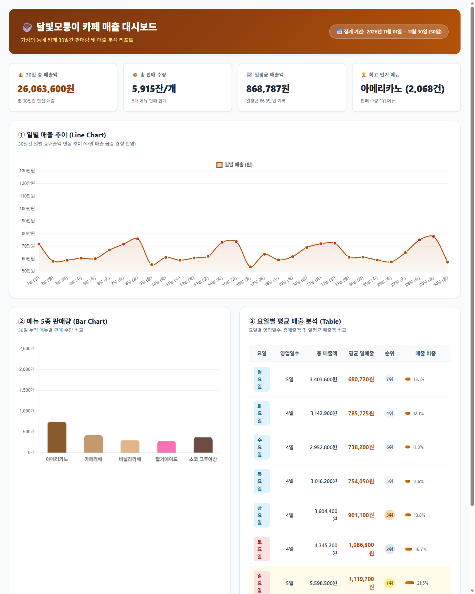

# [실습3] 카페매출 대시보드 / 咖啡店销售数据仪表板

가상의 동네 카페 **「달빛모퉁이 카페 (Moonlight Corner Cafe)」**의 30일간 판매량 및 매출 분석 대시보드입니다.

## 📌 주요 특징
- **무설치 / 무서버 실행**: `index.html` 파일을 더블 클릭하여 웹 브라우저에서 바로 실행 가능합니다.
- **단일 데이터 소스**: `data.js` 내 자바스크립트 변수로 30일 × 5종 메뉴의 판매 데이터를 관리합니다 (별도 CSV 파일 없음).
- **시각화 라이브러리**: Chart.js (CDN) 활용.

## 📁 파일 구조
- `index.html` : 대시보드 UI 구조 및 스타일 (반응형 웹 디자인 적용)
- `data.js` : 30일간 5종 메뉴(아메리카노, 카페라떼, 바닐라라떼, 딸기에이드, 초코 크루아상) 가상 데이터
- `chart.js` : Chart.js 차트 렌더링 및 통계 계산 로직
- `dashboard_screenshot.png` : 브라우저 렌더링 검증 스크린샷

## 🚀 구현 기능
1. **일별 매출 꺾은선 차트 (Line Chart)**
   - 30일간 일별 총매출액 변동 추이 시각화
   - 주말(토/일)과 평일 데이터 포인트 색상 구분 및 마우스 호버 툴팁 제공
2. **메뉴별 판매량 막대 차트 (Bar Chart)**
   - 5종 메뉴별 30일 누적 판매 수량 비교
   - 메뉴별 고유 컬러 및 마우스 호버 시 판매량/총매출 동시 표시
3. **요일별 평균 매출 표 (Table)**
   - 월~일 요일별 영업일수, 총매출액, 일평균 매출액 계산
   - 평균 일매출 기준 순위(1위~7위) 및 매출 비중 프로그레스 바 제공
4. **상단 KPI 요약 카드**
   - 30일 총매출액, 총 판매 수량, 일평균 매출액, 인기 1위 메뉴 요약

## 📊 매출 집계 요약
- **30일 총매출액**: **26,063,600원**
- **총 판매 수량**: **5,915개**
- **일평균 매출액**: **868,787원**
- **인기 1위 메뉴**: **아메리카노** (2,068잔 판매 / 총매출 8,272,000원)
- **최고 매출 요일**: **일요일** (일평균 1,119,700원)

## 🖥️ 실행 화면

